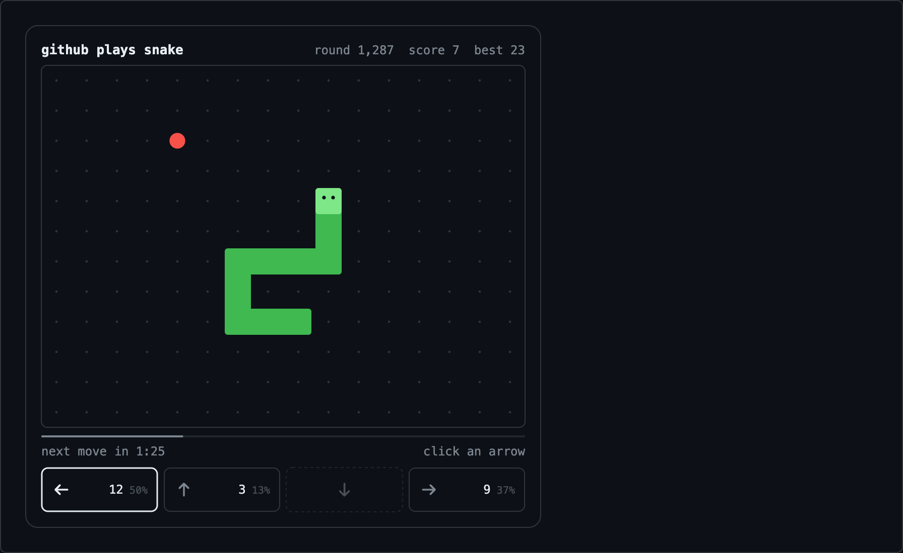
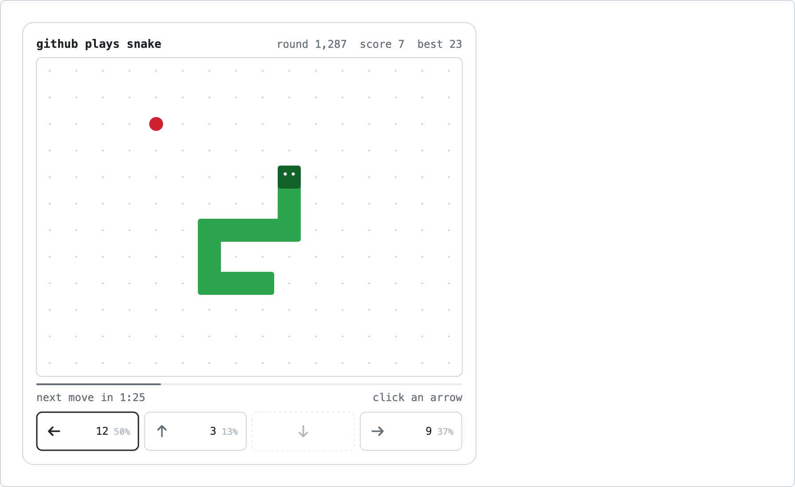
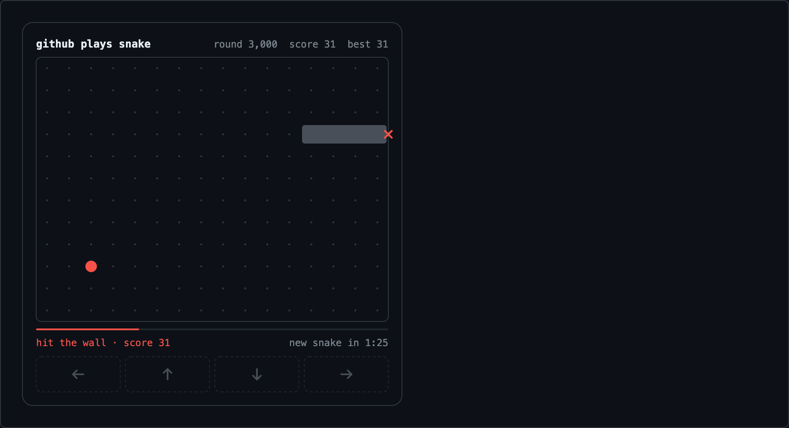

# 🐍 GitHub Plays Snake

**One snake. The entire internet controls it.**

A community-controlled, turn-based Snake game that you play **directly inside a GitHub README**. No JavaScript, no iframe, no separate website. Every visitor sees the same snake and votes on its next move; every two minutes the winning direction is played.

<p align="center">
  
  
</p>

## Play it

<!-- Live instance of this repository. -->
<p align="center">
  <a href="https://xnikcibqhtqn6nwnbz5saqh4pu0blwdb.lambda-url.us-east-1.on.aws/vote?c=">
    <picture>
      <source media="(prefers-color-scheme: dark)" srcset="https://xnikcibqhtqn6nwnbz5saqh4pu0blwdb.lambda-url.us-east-1.on.aws/board.svg?theme=dark">
      
    </picture>
  </a>
</p>

Click an arrow under the board. GitHub reloads and the board shows your vote counted. Come back after the round to see where the snake went.

## Add it to your profile README

Paste this into your profile README (`<username>/<username>/README.md`) and replace `YOUR-FUNCTION-URL` with your deployment's `ServiceUrl` (run `npm run snippet` to print it filled in):

```html
<p align="center">
  <a href="https://YOUR-FUNCTION-URL.lambda-url.us-east-1.on.aws/vote?c=">
    <picture>
      <source media="(prefers-color-scheme: dark)" srcset="https://YOUR-FUNCTION-URL.lambda-url.us-east-1.on.aws/board.svg?theme=dark">
      
    </picture>
  </a>
</p>
```

Rules for the snippet:

- **Keep `width="512"` and do not add a `height`.** Click coordinates are decoded against the 512px layout.
- **Keep `?c=` at the end of the vote link.** See [why](#the-lambda-function-url-comma-quirk).
- Votes redirect back to the `PROFILE_URL` you deployed with (this instance: `https://github.com/PetarIsakovic`), never to a URL from the request.

## How it works

```
 GitHub README                                    AWS (us-east-1)
 ─────────────                                    ───────────────
 <a href=".../vote?c=">                            Lambda Function URL (public HTTPS)
     ── Camo ──▶   HTTP Lambda ──▶ DynamoDB (on-demand)
 click  ──▶ GET /vote?c=?94,585  ────────────▶     │  decode click → record vote
        ◀── 303 See Other → github.com/<you> ─     │  303 back to the profile
 reload ──▶ board.svg (no-cache) ── Camo ──▶      render SVG from authoritative state
                                                  EventBridge Scheduler (every 1 min)
                                                   └▶ Tick Lambda: if round is due → move snake
```

1. **The board is an SVG** generated on every request from the authoritative state in DynamoDB. It is served with `Cache-Control: no-cache, no-store, max-age=0`. GitHub's image proxy (Camo) passes these headers through, so the browser re-fetches the board on every README view. Verified: two Camo fetches of a no-cache image both returned `x-cache: MISS`.
2. **Voting uses the `ismap` attribute**, which GitHub's sanitizer keeps (verified in the rendered HTML of a live README). Clicking an `ismap` image inside a link makes the browser append the click position, `?x,y` in CSS pixels, to the link URL. The server maps that point to a button, records the vote, and answers **303** back to your profile. The page reloads with the updated tally.
3. **Rounds** last 120 seconds (configurable). EventBridge Scheduler invokes the tick Lambda every minute. It advances the game only when the authoritative `nextTickAt` has passed. Any request that notices an overdue round also triggers the (idempotent) tick, so the round closes on time whenever someone is watching.

Idea credit: the `ismap` + `303` + `no-cache` technique comes from [Placefile](https://github.com/cnrad/placefile) (MIT).

## Gameplay

- Vote with the four arrows: **← ↑ ↓ →**, in screen directions. The arrow that would send the snake straight back into itself is shown dashed and doesn't count.
- **Highest vote wins.** A tie for first place, or zero votes, means the snake **keeps going** the way it's heading.
- One effective vote per visitor per round. **Clicking again changes your vote** instead of adding a second one.
- Eating an apple grows the snake and scores a point. Hitting a wall or its own body ends the run. Moving into the cell the tail is leaving is allowed.
- **Game over** is displayed for 30 seconds (with the crash marked on the board), then a new snake hatches automatically. Best score, total moves, total votes and games played persist. Filling the whole board ends the run as a win.

<p align="center"></p>

### Defined behavior for edge cases

| Situation | Behavior |
|---|---|
| Zero votes / tie for first | Snake keeps its current heading |
| Vote for the reverse direction | Rejected (the arrow is drawn disabled; clicks on it are ignored) |
| Same visitor clicks again (same or different button) | Vote is replaced, never double counted (cookie-keyed, conditional write) |
| Rapid repeated or simultaneous clicks | Conditional writes on the visitor's record. One effective vote. Tested with real concurrency. |
| Many visitors at once | Atomic `ADD` counters on one item. No read-modify-write. 60 truly concurrent votes on real DynamoDB counted exactly. |
| Vote arrives after the deadline but before the tick ran | The voter's request runs the overdue tick first, then counts the vote in the new round. |
| Vote races the tick | The tick first atomically **closes** the round's tally (`SET closed` + `ReturnValues`). A vote either lands before the close (counted in the move) or fails its `attribute_not_exists(closed)` condition and is retried into the next round. Never lost, never double counted (tested on real DynamoDB). |
| Duplicate / retried / concurrent scheduler events | The state commit is conditioned on `version`. Exactly one tick wins. Losers re-read and see "not due". |
| Late scheduler (outage) | Moves **one** step only, and gives the next round at least half the duration |
| Game over / reset retried | Same version guard. A run summary is written with `attribute_not_exists`, so it is recorded exactly once. |
| Votes during the game-over screen | Not accepted (arrows drawn disabled) |
| Board completely full | Run ends as **won** ("BOARD CLEARED!"), new snake next round |
| Apple spawn | Uniform over empty cells only, from a seeded PRNG stored in state (deterministic, testable) |
| Lambda restart / cold start | State lives only in DynamoDB. Nothing important is in memory. |
| Corrupted state item | Detected by validation, replaced by a fresh run that keeps lifetime stats |
| DynamoDB error while rendering | A friendly "snake is napping" SVG (HTTP 200), never a broken image |
| DynamoDB error while voting | Visitor is still redirected back. The error is logged. |
| Invalid / out-of-range / malformed coordinates | Redirect back, no vote |
| Click on the board, header or side panel | Redirect back, no vote |
| Missing or malformed cookie | Treated as a new visitor (new random id issued) |
| Unexpected HTTP method | `405` with `Allow: GET, HEAD` |
| SVG requested during a tick | Reads the last committed state. Commits are atomic, so a half-applied move is never seen. |
| Stale README | The board says when the next move happens and counts down. After the deadline it says "Reload to see it". It never pretends to be live. |

## Known GitHub limitations (and what we do about them)

**Image scaling.** GitHub renders README images with `max-width: 100%`, and the browser reports click coordinates in the *rendered* size. The board is deliberately 512px wide (about 500px tall, so it fits on a MacBook screen without scrolling). That is narrower than the README column on any laptop or desktop window (about 730px on a 1245px-wide window, 846px at ≥ 1280px), so it is never shrunk there and clicks are exact. If it is shrunk (a very narrow window or a phone), the server cannot know the scale factor. This project handles it as follows:

- The vote buttons form the **bottom edge** of the image. Every possible true click position lies on a ray from the top-left corner through the reported point. A vote is counted only when no *other* button lies on that ray. Result: **a click on a button is never counted for a different button, at any scale** (exhaustively tested from 25% to 100% scale, and with real Chrome at 731/500/470/343px columns).
- Laptop and desktop windows: all clicks work. Phones: image clicks are ignored.
- Phones can watch but not vote. Voting is only possible by clicking the arrows on the board image; there are no vote links.

**The Lambda Function URL comma quirk.** Browsers append `?x,y` to the link. Lambda Function URLs reject a query string whose *key* contains a comma (`/vote?84,585` → `400` before any code runs; verified live). The embed's link therefore ends in `?c=`. Per the WHATWG "follow the hyperlink" algorithm, the browser appends the suffix to the serialized URL string, producing `/vote?c=?84,585`. The comma then sits inside a value, which Function URLs accept. Verified in real Chrome against the live deployment.

**No live updates in an open tab.** README images aren't re-fetched while you sit on the page. The board shows an honest countdown (SMIL animation, which `` allows). When it reaches zero, a translucent overlay with a big refresh icon covers the board. Any click on the image reloads the profile, because every click goes through `/vote`, which always redirects back. A click that lands on an arrow under the overlay also counts as a vote for the new round.

**Camo's CSP** (`default-src 'none'; img-src data:; style-src 'unsafe-inline'`) blocks web fonts and external resources inside the SVG. The renderer uses system font stacks and inline geometry only.

**Anonymous voting is best-effort.** Clicking an image tells us nothing about the GitHub account. Identity is a random id in a `Secure; HttpOnly; SameSite=Lax; Path=/vote` cookie. Clearing cookies makes a "new" visitor, which a per-IP-per-round cap (default 12) bounds. Votes cannot be tied to GitHub users without OAuth, which is out of scope.

**The GitHub mobile app** may not support `ismap` at all.

## Architecture

```
src/
  game/       pure engine: types, rng, directions, engine (step/advance), voting   ← no I/O
  render/     layout (shared geometry), theme (dark/light), svg (renderer)
  http/       router (transport-agnostic), ismap (click decoding), identity (cookie + HMAC)
  service/    game-service: idempotent tick, vote retries, lazy catch-up, reset
  storage/    repository interface, DynamoDB implementation, in-memory implementation
  lambda/     http (Function URL handler, gzip), tick (scheduler + IAM-only admin)
  dev/        local server + preview page
  embed.ts    the README snippet
infra/        AWS CDK (TypeScript)
tests/        unit · integration · e2e · browser (real Chrome)
scripts/      build, screenshots, admin, live-check, snippet
```

**DynamoDB single-table model** (on-demand billing, point-in-time recovery, TTL on per-round items):

| pk | sk | item |
|---|---|---|
| `GAME#<gameId>` | `STATE` | authoritative game state, `version` for optimistic concurrency |
| `GAME#<gameId>` | `RUN#000000042` | summary of each finished run |
| `ROUND#<gameId>#<round>` | `TALLY` | `up` / `down` / `left` / `right` atomic counters, `closed` flag |
| `ROUND#<gameId>#<round>` | `VOTE#<hash>` | one visitor's current choice (HMAC of cookie id) |
| `ROUND#<gameId>#<round>` | `IP#<hash>` | per-IP vote counter (HMAC of IP) |
| `META` | `SECRET#visitor-hmac` | random HMAC key, created once, never leaves the backend |

**Multi-profile ready:** everything is keyed by `gameId` (`global` today). Adding `/u/<user>/board.svg` later means mapping the path to `gameId = u:<user>` and the redirect to `https://github.com/<user>`. No schema change.

**AWS resources** (one CloudFormation stack, `GitHubPlaysSnake`): a DynamoDB table; two Lambdas (Node.js 22, arm64), one behind a public Function URL with reserved concurrency 50, the other run by the scheduler with reserved concurrency 2; an EventBridge Scheduler schedule (every minute); two log groups with 2-week retention; two CloudWatch alarms (tick errors, HTTP errors/throttles); and least-privilege IAM roles (only `GetItem/PutItem/UpdateItem/DeleteItem/ConditionCheckItem/Query` on this table). No API Gateway, no EC2, no custom domain.

## Local development (no AWS needed)

```bash
npm install
npm run dev            # http://localhost:8787, 20-second rounds, in-memory store saved to .dev-state.json
```

The preview page embeds the board with the exact README markup (dark and light). It has buttons to **force a tick**, **cast simulated votes**, **reset** or **hard reset**, and **simulate narrower README columns**. A live JSON view shows the internal state. `ROUND_SECONDS=5 npm run dev` gives faster rounds.

```bash
npm test               # unit + integration + e2e (DynamoDB tests auto-skip)
npm run typecheck      # app + infra
npm run build          # bundle both Lambdas into dist/ (esbuild)
npm run test:browser   # real headless Chrome clicks the ismap embed (needs Google Chrome)
npm run screenshots    # render all states/themes/widths to screenshots/*.png
npm run test:dynamo    # DynamoDB repository tests against DynamoDB Local on :8000
```

DynamoDB Local without Docker: download the [official jar](https://docs.aws.amazon.com/amazondynamodb/latest/developerguide/DynamoDBLocal.DownloadingAndRunning.html), then run `java -Djava.library.path=DynamoDBLocal_lib -jar DynamoDBLocal.jar -inMemory -port 8000`.

## Deploy to AWS

Prerequisites: Node 20+, an AWS CLI profile with permission to deploy CloudFormation/IAM/Lambda/DynamoDB/Scheduler, and a one-time `npx cdk bootstrap` in the target account/region.

```bash
export AWS_PROFILE=your-profile AWS_REGION=us-east-1
PROFILE_URL=https://github.com/<your-username> npm run deploy
npm run snippet        # prints your ready-to-paste README snippet
npm run live-check     # real Chrome: click → 303 → vote counted, against the live URL
```

Redeploy any time with different settings. The game state is kept (the table is retained even if the stack is deleted).

**Admin** (IAM-authenticated Lambda invoke; there is no public admin endpoint):

```bash
npm run admin -- state | runs | tick | expire-round | reset | hard-reset
```

### Configuration

| Variable | Default | Meaning |
|---|---|---|
| `PROFILE_URL` | (required at deploy) | Where voters are redirected (`https://github.com/<user>`). Validated; never taken from requests. |
| `ROUND_SECONDS` | `120` | Voting round length |
| `BOARD_COLS` / `BOARD_ROWS` | `12` / `9` | Board size (applies from the next run) |
| `GAMEOVER_SECONDS` | `30` | How long the game-over screen stays before a new snake starts |
| `VOTES_PER_IP_PER_ROUND` | `12` | Abuse cap per hashed IP per round |
| `HTTP_CONCURRENCY` | `50` | Reserved concurrency (hard ceiling on cost and abuse) |
| `STACK_NAME` | `GitHubPlaysSnake` | CloudFormation stack name |

## Cost

Assumptions: us-east-1, on-demand pricing, arm64 Lambda (HTTP 512 MB at ~50–80 ms warm, tick 256 MB), ~3 strongly consistent reads per board view, about 8 write units per vote, a 3–4 KB gzipped SVG, and 2-week log retention.

| Traffic | Lambda | DynamoDB | Scheduler | Logs + alarms | **Total / month** |
|---|---|---|---|---|---|
| Low: 1k views/day, 100 votes/day | ~$0.05 | ~$0.15 | ~$0.05 | ~$0.25 | **≈ $0.50** |
| Moderate: 100k views/day, 10k votes/day | ~$2 | ~$3 | ~$0.05 | ~$0.80 | **≈ $6** |
| Viral: 1M views/day | ~$20 | ~$25 | ~$0.05 | ~$6 | **≈ $50**, capped by reserved concurrency |

Free tiers (Lambda, Scheduler, 100 GB/month data transfer) push the low tier toward ~$0.20. The scheduler's 43,200 invocations a month are well inside its free tier. Gzip keeps egress tiny (~3 KB per view).

## Security

- No credentials in code; least-privilege IAM per function. Admin actions require AWS credentials (Lambda invoke).
- The redirect target is fixed at deploy time and validated (`https://github.com/...` only). Requests cannot change it.
- Strict input validation: only `x,y` / `c=?x,y` with small integers, a single vote endpoint, `GET`/`HEAD` only, everything else `404`/`405`.
- SVG text is XML-escaped. The SVG has no scripts or external references and is served with a restrictive CSP and `nosniff`.
- Privacy: raw IPs and cookie ids are never stored or logged; only HMACs keyed by a server-side random secret. Per-round items expire via DynamoDB TTL. `/state.json` exposes no visitor data and no RNG seed.
- Abuse limits: per-IP-per-round vote cap, reserved Lambda concurrency, `robots.txt` disallow, and `X-Robots-Tag: noindex` on vote redirects.

## Acknowledgments

- **[Placefile](https://github.com/cnrad/placefile)** by Conrad Crawford (MIT): the `ismap` + 303 + no-cache README interaction technique, and the 846px column measurement. Ideas re-implemented here in TypeScript for AWS.
- **[Twitter Plays Snake](https://github.com/PolyMarsDev/Twitter-Plays-Snake)** by PolyMars: the community-voting Snake concept. No code was used; this engine is an original implementation.
- **[GitHub README Chess](https://devpost.com/software/github-readme-chess)**: prior art on interactive READMEs and image caching.
- **[Platane/snk](https://github.com/Platane/snk)**: visual inspiration for README snakes.

## License

MIT. See [LICENSE](LICENSE).
